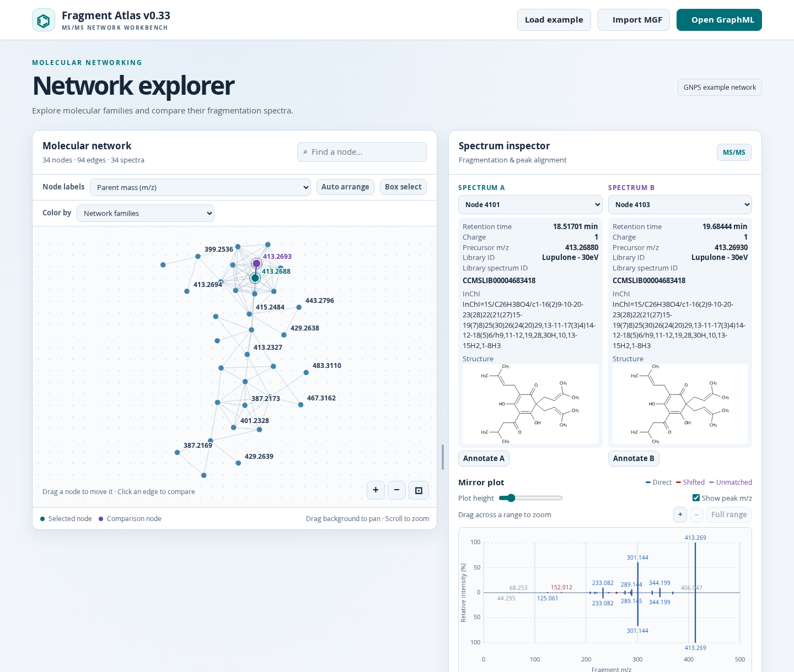
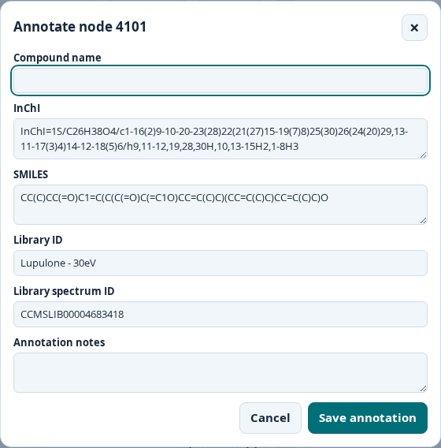

# Fragment Atlas v0.33

Fragment Atlas is an offline viewer for GraphML molecular networks and tandem mass spectra. Open your network, link a companion MGF, compare fragment peaks, and save node annotations back to GraphML.

## Download and open

1. Open [fragment-atlas-v0.33-gnps-offline.html](fragment-atlas-v0.33-gnps-offline.html) on GitHub and click **Download raw file**. If you already downloaded the file from a release, skip this step.
2. Open the downloaded `.html` file in a current browser. If it opens in a text editor, right-click it and choose **Open with** your browser.
3. Click **Load example** to try the controls with the bundled GNPS dataset, or import your own GraphML and MGF.

The HTML contains the whole app, including the 2D structure renderer and a GNPS example. It runs from the local file without installation, a server, or an internet connection. GraphML and MGF data are processed in your browser.

The built-in GNPS example includes the supplied GraphML network of **34 nodes and 94 edges** and the **34 matching spectra** from its companion MGF. Each example spectrum is linked by scan ID.

## Open a network and link spectra

1. Click **Open GraphML** and choose your network.
2. Click **Import MGF** and select the matching MGF file or files in one import.
3. Check the status below the workspace for the linked-node count.

Fragment Atlas first tries MGF `SCANS` or `FEATURE_ID` against the GraphML scan or feature identifier and node ID, then tries an exact MGF `TITLE` match. If a scan identifier occurs more than once, that scan match is treated as ambiguous. Nodes can also show peaks embedded in GraphML. Importing another MGF selection replaces the current set of imported spectra.

## Explore and arrange the network

| Action | Control |
| --- | --- |
| Inspect a node | Click the node or choose it in the **Spectrum A** menu. |
| Compare two nodes | Click their connecting edge, Shift-click a second node, or choose the nodes in the **Spectrum A** and **Spectrum B** menus. |
| Find a node | Use the network search to find it by ID, scan, or label. |
| Move or group nodes | Drag a node. To move several together, use **Box select**, draw around the nodes, then drag one of the outlined nodes. |
| Refit or rearrange | Use **Fit network** to recenter the view or **Auto arrange** to recompute positions. Drag the background to pan and scroll to zoom. |
| Change labels | Choose an attribute under **Node labels**. Parent mass is selected initially. |
| Color by an attribute | Choose a GraphML column under **Color by** and open **Color legend**. A column of hex colors is used directly. Missing values appear in gray. |

Manual positions last for the current session. GraphML export saves edits to node attributes and preserves the original network topology.

## Inspect and align spectra

The inspector shows each selected node’s precursor m/z, retention time, charge, and library identifiers when available. It displays a mirror plot when two spectra are available.

- Use **Plot height** to resize the plot. On desktop, drag the divider between the network and inspector to change the pane width.
- Drag across an m/z interval to zoom. Use **Full range** to reset it. **Show peak m/z** labels peaks where space permits.
- Set **Peak tolerance** in Da. **Direct m/z** compares fragment masses directly. **Direct + precursor shift** also considers matches after shifting by the precursor m/z difference.
- Blue marks direct matches, red marks shifted matches, and gray marks unmatched peaks. Click a matched peak or use **Matched peak pairs** to see its partner and signed **A − B** difference.
- The similarity score uses the full spectra even while the plot is zoomed. Fragment Atlas calculates its own peak matches and cosine score from the loaded peaks and current settings. GNPS jobs can use different preprocessing and settings.

## Annotate and export nodes

1. Select the node and click **Annotate A** or **Annotate B** above its spectrum.
2. Enter the compound name, InChI, SMILES, library ID, library spectrum ID, or notes.
3. Click **Save annotation** to update the node’s GraphML row. The form reuses compatible existing fields and creates a string column for a new field when needed.
4. Click **Export GraphML** to download an edited copy. Reopen that copy and reimport the MGF to continue a saved session.

For other attributes, use the searchable **GraphML node table**. An InChI beginning with `InChI=1/` or `InChI=1S/` is displayed in the inspector. A valid, supported InChI also produces a 2D depiction. The original identifier stays visible if rendering fails. The depiction uses the bundled Indigo engine and requires no external lookup.

GraphML export does not embed a separately imported MGF. Keep the MGF alongside the edited network.

## Troubleshooting

| Symptom | Check |
| --- | --- |
| Zero nodes link to spectra | Compare the node IDs and scan attributes with MGF `SCANS`, `FEATURE_ID`, or `TITLE`. Use the MGF exported for that network. |
| No shifted matches appear | Select two spectra with precursor m/z values, choose **Direct + precursor shift**, and check the peak tolerance. |
| The InChI is visible but no structure appears | Check that the identifier is complete, and try a current browser. |
| Edits vanished after closing the tab | Export a GraphML copy before leaving the session and reopen that copy next time. |

## Release files

Add `README.md`, `docs/screenshots/`, and `fragment-atlas-v0.33-gnps-offline.html` to the GitHub repository. For a downloadable release, attach the same HTML file as the release asset. Users can open the downloaded file directly.

The local InChI depiction uses [Indigo](https://github.com/epam/Indigo) from `indigo-ketcher` 1.46.0. The HTML includes the renderer's Apache-2.0 license.
